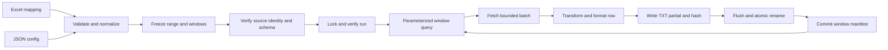

# SQL Exporter solution design

Engine 1.1 adds a shared canonical JSON/Excel mapping layer, deterministic related UUID identities, source-field templates, explicit text conversion, prefix/suffix operations, and a detached Codex/external normalization worker. `DEVELOPER_GUIDE.md` documents the new environment setup and workflow. General document interpretation happens before export; validated declarative rules remain the only executable mapping language. The AdventureWorks example demonstrates 120,029 detail rows with linked order/customer/product files and pinned source provenance.

## Scope and result

Export one SQL Server table per configuration over a configurable rolling three-year range, apply an Excel-defined output schema and declarative rules, and deliver pipe-delimited TXT files split into calendar windows. Mapping changes within the supported contract are data changes. The CLI offers offline validation, a read-only plan, source preflight, export, and safe window-level resume.

No actual workbook, database credentials, table/date definition, interval, or preferred language was supplied. The repository was empty. The implementation therefore uses Python 3.10+, JSON configuration, a documented sample workbook, a synthetic JSONL adapter, UTC time, and monthly windows. The SQL adapter uses pyodbc, openpyxl reads XLSX, xlrd plus an OLE/BIFF guard reads XLS, and filelock supplies an operating-system lock. The sample workbook is a fixture; the CLI does not need the spreadsheet authoring tool used to create it.

## Data flow



`validate` stops after contract validation unless `--connect` requests source preflight. `dry-run` emits a plan without opening the source or writing any files. `export` validates and opens the source before creating the run. Resume checks every completed file before writing the next one.

## Components

| Module | Responsibility |
| --- | --- |
| `config.py` | Strict config parsing, defaults, identifiers, relative path resolution. |
| `mapping.py` | Workbook loading, formula rejection, contract validation and semantic fingerprint. |
| `transforms.py` | Validated operation vocabulary, null handling, exact conversion and formatting, and the compile-once rule pipeline. |
| `windows.py` | UTC normalization, calendar-year subtraction, clipped nonoverlapping windows. |
| `sources.py` | Explicit-column parameterized SQL, metadata checks, fetchmany iteration; offline JSONL fixture adapter. |
| `serialization.py` | UTF-8 pipe CSV dialect, lossless quoted delimiters/newlines, null collision rejection. |
| `engine.py` | Exclusive lock, frozen run identity, integrity checks, streaming write, atomic publication and resume. |
| `cli.py` | Workflows, JSON results, progress/error handling and exit codes. |

## Time boundaries

Let `E` be explicit end or current UTC instant. Let `S` be explicit start or the same calendar instant three years before E. February 29 clamps to February 28 in a non-leap destination year. This means calendar years, not 1,095 days. Explicit start/end take priority over the years default.

Partition `[S,E)` at UTC calendar day, month, quarter, or year boundaries. First and last windows clip exactly to S and E. Every SQL query uses:

```sql
SELECT [OrderId], [CreatedAt], [Customer], [Amount], [Status], [Note]
FROM [dbo].[Orders]
WHERE [CreatedAt] >= ? AND [CreatedAt] < ?
ORDER BY [CreatedAt], [OrderId]
```

Values are separate UTC-naive Python datetime parameters, never interpolated strings. Validated identifiers are quoted independently. The predicate applies no function to the date column, allowing an appropriate date index to support range access. Null date values are naturally excluded; the exporter does not add an undated file.

The default rolling range often yields 37 monthly files, with partial first and last months. Exactly 36 files require a month-aligned three-year range, as used by the fixed demo. Resume reuses the persisted bounds; it never recomputes “now.” Datetimes are supported to microsecond precision. Scale-7 selected SQL datetime2 columns fail preflight to prevent data loss; UTC datetimeoffset is an explicit future extension.

## Mapping evolution

The workbook has contract_version, mapping_id, mapping_version, and ordered output columns. Each column names a source or constant, target, final type, nullability, scale where relevant, and a JSON operation pipeline. Rules include trim, case changes, literal replacement, default, constant, exact multiplication, and explicit lookup. Unsupported prose, formulas, parameter typos, extra columns, duplicate output names, and unknown operations are rejected.

Canonical sorted JSON of the normalized model produces a SHA-256 fingerprint. Formatting changes do not alter it; semantic changes do, even without a mapping-version bump. Run metadata stores the model and original workbook byte hash for audit. Supported metadata edits require a new workbook/config and output directory, with no engine code changes. Adding a new operation requires implementation and tests; the design intentionally does not pretend arbitrary business prose is executable.

## Streaming and performance

The mapping is compiled once per export into one closure per target column, with rule-determined constants resolved up front: identity namespace UUIDs, parsed template fields, decimal factors and quantizers, lookup tables, nullability, and source keys. `transform` and `apply_rules` remain as shims over the same compiler, so no second implementation can drift from it. A source that yields sequences rather than mappings advertises a `layout`, and the compiler binds column names to positional indexes; the source verifies the driver's reported description still matches that layout before the first row of each window. Identity results are memoized per rule within a bounded cache, because a foreign-key identity recurs across many rows and its derivation is a pure function of the key values.

Each window executes one SELECT projecting only unique mapped source columns. `fetchmany(batch_size)` retrieves up to 5,000 rows by default. Each row is transformed, serialized, written, and included in a streaming SHA-256. The engine never accumulates a table or a whole window. Memory is proportional to a bounded number of rows times their width, plus the small workbook and window plan; it is not a fixed byte ceiling for arbitrarily large SQL LOB fields. pyodbc documents both parameter binding and bounded batch retrieval in its [cursor API](https://github.com/mkleehammer/pyodbc/wiki/Cursor).

The engine makes no preliminary COUNT query. Counts reflect successfully written records. It does not use OFFSET paging, which can repeatedly rescan preceding rows and complicate consistency during concurrent updates. Window selection is sequential to limit database pressure. Optional ORDER BY can require a server sort; a DBA should assess an index beginning with date_column and the requested stable tie-breaker, with appropriate includes, using the actual query plan. There is no blanket index creation or performance promise without real data.

The offline adapter rereads a sorted-or-unsorted JSONL fixture for each window and preserves file order. It bounds each input line to 16 MiB and never loads the whole fixture. This deliberately simple adapter is suitable for tests/demos, not an optimized file warehouse. Runtime is O(windows × fixture rows); SQL performance depends on indexing and server plans.

## Serialization contract

TXT uses UTF-8 without BOM, a pipe delimiter, LF record terminators, and CSV double-quote escaping. Empty strings are quoted empty fields. Null defaults to unquoted `\N`; identical non-null values fail to avoid ambiguity in ordinary CSV readers. Delimiters, CR, LF, quotes, and Unicode remain lossless. Multiline fields mean physical line count is not record count.

Final types are string, exact signed 64-bit integer, fixed-scale decimal with ROUND_HALF_UP, ISO date, UTC datetime with six fractional digits, or lowercase boolean. Decimal input/factors use integer, Decimal, or exact text; binary floats are rejected. Defaults replace null, not empty/zero/false. Invalid rows fail the window rather than silently being omitted. The complete receiver contract and supported operations are in `MAPPING.md` and README.

## Publication, provenance, and resume

The output directory belongs to one run. A new export requires an empty directory. A filesystem lock prevents cooperating processes from concurrently writing it. New files use mode 0600 and a newly created output directory uses 0700 on POSIX, subject to operating-system semantics; existing parent/directory permissions are not changed.

The run fingerprint covers manifest version, engine version, Python/package versions, mapping fingerprint/model and original workbook hash, requested effective configuration, source identity, and the frozen window plan. SQL identity includes server/database and a hash of table column metadata. JSONL identity is a streaming hash of the entire file. Connection strings and passwords are excluded. Runtime/package changes are conservatively refused on resume to prevent differing transformation semantics. Changes to native driver installation should also be managed as part of a controlled run environment.

For each incomplete window:

1. Remove only that verified run's known stale partial/orphan data and partial manifest.
2. Write `window.txt.part`, computing row count, byte count, and SHA-256 as bytes stream out.
3. Flush and fsync the data file, then rename atomically to `window.txt` on the same filesystem.
4. Write/fsync a temporary manifest and rename it atomically to `window.json`. POSIX parent directories are also fsynced.

The window JSON manifest is the commit marker. A TXT without a matching complete, compatible manifest is not committed output. If interruption occurs before the marker, resume re-extracts the whole window. If interruption occurs after it, resume verifies size/hash and skips the window. Empty windows also receive files and manifests, proving coverage.

Before any resume writes, all completed windows are checked for compatible run/window metadata and matching data size/hash. Corruption or missing committed files stops the run. Unknown files and symlinks are refused; output directories are assumed to be trusted local directories, not hostile directories subject to concurrent path replacement. Locks and rename/fsync guarantees on network shares, object-storage mounts, and Windows power loss have not been validated. Use local storage and copy only verified completed artifacts downstream.

Failures record a small `failure.json` containing window and prior row count, without row values. Partial files may contain source data and need the same access/retention controls as completed exports. A transformation failure can be addressed by fixing the source under an appropriate consistency policy and resuming, or by changing the mapping and starting a new run. Resume cannot append under different settings. A crash before the initial run manifest commits requires a new directory.

## Database consistency and operational limits

READ COMMITTED is the default. Whether it uses locks or row versions depends on SQL Server configuration. The optional SNAPSHOT mode starts a separate transaction for each window and commits it after source iteration completes. SQL Server requires ALLOW_SNAPSHOT_ISOLATION for snapshot transactions; see Microsoft's [isolation documentation](https://learn.microsoft.com/en-us/sql/t-sql/statements/set-transaction-isolation-level-transact-sql?view=sql-server-ver17).

Neither mode creates a single historical snapshot spanning all windows and resumes. Inserts, deletes, updates, and changed date values can affect later windows or retries. The manifests prove file integrity and configuration consistency, not global source completeness under mutation. Use an immutable staging extract/database snapshot for repeatable output, and identify it using source_id/source_revision. Identity/schema checks cannot detect every restore or content change under the same SQL server/database name. JSONL contents are assumed immutable during an invocation; their hash is verified afresh when opening the source on resume.

Retries are operator-triggered via resume; there is no infinite retry loop or row quarantine. Query/connect timeouts bound individual driver operations, not overall run time. Selected datetime2 precision >6, datetimeoffset, arbitrary SQL/joins, expressions, binary/spatial/CLR conversion, compression, destination upload, scheduler integration, and cross-table dependencies are outside v1. A unique ORDER BY key is the operator's responsibility; omitted or nonunique ordering may vary between fresh extractions.

## Validation evidence and rollout

Automated tests exercise calendar/leap boundaries and half-open membership, all transformation families, large exact decimals and rounding, null versus empty, CSV round trips with pipes/quotes/CR/LF/Unicode, real XLS and XLSX imports, cached-formula rejection, strict schema/rule validation, parameterized SQL/fetchmany behavior with mocks, failure cleanup, interruption before manifest commit, lock conflicts, corrupt output refusal, frozen-now resume, and mapping/source/settings changes. The CLI demo exports five synthetic rows across 36 files and then verifies/skips all 36 on resume.

The sample workbook was inspected, rendered, and reimported. No SQL Server instance/credentials were supplied and the development host lacked unixODBC. Installing pyodbc and passing mock tests are not a live-database validation. Before production use, install the native driver, validate source metadata, run an explicit small interval against a stable test dataset, compare counts and representative values, inspect the real query plan, exercise interruption/resume against the chosen storage, and confirm the receiver accepts the specified TXT dialect.

Extensions can add declarative operations behind a versioned registry, additional source adapters, approved joins through prepared staging tables, separate multi-table orchestration, richer date precision, and immutable snapshot integration. Preserve the window commit protocol and require a new engine/contract identity when semantics change.
