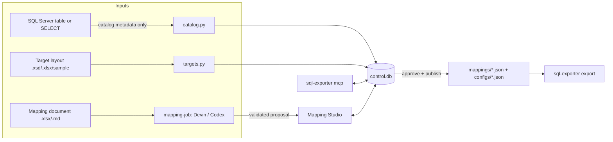

# Mapping Studio, SQL MCP server, and Devin mapping generation

Engine 1.3 adds an authoring layer in front of the exporter. You describe a SQL Server table or
SELECT query and import the required target file layout from an XSD, Excel, or sample file. You
map columns by drag and drop, or let Devin propose the mapping from a business mapping document.
Everything is kept in a local SQLite control database. Approving a mapping publishes the same
mapping JSON and config JSON that `sql-exporter export` already runs.



## Trust boundaries

- **Only metadata leaves the database.** The catalog reads `sys.objects`, `sys.columns` and
  `sys.dm_exec_describe_first_result_set` with bound parameters. Nothing in Studio, MCP, or the
  Devin flow reads table rows. The single exception is **Preview**, which runs only on an offline
  JSONL fixture.
- **Secrets stay in environment variables.** A connection stores only the *name* of an
  environment variable that holds the ODBC connection string. `DEVIN_API_KEY` and
  `SQL_EXPORTER_MCP_TOKEN` are read from the environment and never written to the workspace.
- **AI proposes and a person approves.** Devin, Codex, and MCP agents can create drafts. Approval is
  a person's action in Studio (or `Control.approve`). Every proposal is re-validated locally against
  the mapping contract, the captured source columns, and the target spec.
- **What goes to Devin.** The prompt contains the contract, the mapping document text, source column
  names and types, and the target spec. It contains no rows, credentials, or file paths.
- **SQL text.** A source query is one read-only `SELECT` typed into the source definition by a
  person. It is never taken from a workbook or from AI output.

## Install

```sh
python -m pip install -e '.[sqlserver,mcp]'
```

`mcp` is only needed for `sql-exporter mcp`. Studio and the Devin provider use the standard library.

## 1. Create a workspace

```sh
sql-exporter studio init --workspace mapping-workspace
```

This creates `control.db` plus `uploads/`, `targets/`, `mappings/`, `configs/`, `jobs/`, and
`exports/`. Keep the workspace under backup. `mappings/` and `configs/` are suitable for version
control.

## 2. Start Mapping Studio

```sh
export WAREHOUSE_ODBC='Driver={ODBC Driver 18 for SQL Server};Server=sql01;Database=Sales;Trusted_Connection=yes;Encrypt=yes'
export DEVIN_API_KEY='...'          # only for "Generate with Devin"
sql-exporter studio serve --workspace mapping-workspace
```

On Windows PowerShell, use `$env:WAREHOUSE_ODBC = '...'`.

Studio listens on `127.0.0.1:8765` only. It prints a URL that includes a one-time access token,
and you open that URL. Requests without the token, or with a non-loopback `Host` header, are
refused.

### Workflow on the canvas

1. **Source** (left).
   - Press **+**, add a connection (a name plus the environment variable name), then choose:
     - **SQL Server table or view**: press **List** to browse, then **Describe columns**.
     - **SQL Server SELECT query**: paste one SELECT. Joins and filters are allowed. A top-level
       `ORDER BY`, `;`, comments, `INTO`, `EXEC`, DML, and DDL are rejected. Alias computed
       columns.
     - **Offline JSONL fixture**: for demos and tests.
   - Pick the UTC window column, the granularity, and the range, then save. The column metadata is
     captured into control.db.
2. **Target** (right).
   - Press **Import** and choose:
     - an `.xsd`: the first flat `xs:sequence` of simple-typed elements becomes the columns.
       `xs:decimal` needs `fractionDigits`. `minOccurs="0"` or `nillable` means nullable.
     - an Excel file with a `Target` sheet (`ordinal | name | type | nullable | scale`) and an
       optional `File` sheet (`key | value`).
     - a target spec `.json`.
     - a sample delimited file. Names come from its header, every column starts as a nullable
       string, and you then fix the types.
   - With no column selected, the inspector edits the target file settings and shows a live
     example file name: pattern, extension, delimiter, header, line ending, encoding, and null token.
3. **Map.**
   - **Auto-map by name** matches names ignoring case and underscores.
   - Drag any source column onto a target column. Drop it on the dashed zone to add a new target
     column.
   - Click a target column to edit its type, nullability, scale, and ordered **logic**: trim,
     upper, lower, replace, default, constant, multiply, lookup, prefix, suffix, to_string,
     identity, and template. Drag source columns onto an identity rule's key box.
   - **+ Derived column** adds a constant, identity, or template column.
   - Lines show which source columns feed each target. Dashed lines are extra inputs (identity
     keys or template fields).
4. **Validate.** The issues bar shows contract errors and any mismatch with the target spec or with
   the captured source columns. Validation also runs automatically while you edit.
5. **Save draft**, then **Approve & publish**. Approval needs zero issues and writes
   `mappings/<id>-<version>.json` and `configs/<id>-<version>.json`. An approved version is
   immutable: use **More > New version** to change it. Each version exports into its own
   `exports/<id>-<version>/`.
6. **Run.** **More > Dry run** shows the SQL and the file names. **Export** runs in the background
   and is recorded under **Export history**. Or run the published config from a shell or a scheduler:
   ```sh
   sql-exporter export --config mapping-workspace/configs/orders-1.0.0.json
   ```

**More** also offers:
- **Preview on fixture**: shows transformed rows for JSONL sources.
- **Import mapping file**: a strict contract `.xlsx`/`.xls`/`.json`.
- **Download JSON / Excel**: the Excel download round-trips through the contract importer.
- **Retire** and **Audit log**.

### Generate with Devin

**Generate with Devin** sends the uploaded mapping document (optional), the selected source's
column metadata, and the selected target spec. The job runs as a detached local worker. It creates
a Devin session through the Devin v1 API and polls it, and the session link appears in the dialog.
When Devin finishes, its structured output is validated locally. Studio then shows it as a
**proposal** with per-column ✓ / ✗ buttons and **Accept all** / **Discard**. Nothing is saved
until you save the draft.

The same flow is available without the UI:

```sh
sql-exporter describe --connection-env WAREHOUSE_ODBC --table dbo.Orders > orders.columns.json
sql-exporter mapping-job start --provider devin --input business-mapping.xlsx \
  --source-metadata orders.columns.json --target-spec orders.xsd --timeout 1800
sql-exporter mapping-job status --job-dir .mapping-jobs/<id>
```

`--input` is optional when both `--source-metadata` and `--target-spec` are given. Set
`DEVIN_API_BASE` only if your organization uses a different Devin API endpoint. A session that
stays `blocked` without output keeps polling until the timeout, so you can answer Devin in its UI.
Cancel and timeout terminate the remote session.

## 3. SQL MCP server

The MCP server lets an agent such as Claude Code, VS Code, or another MCP client work against the
same workspace.

```sh
sql-exporter mcp --workspace mapping-workspace                      # stdio
SQL_EXPORTER_MCP_TOKEN=$(python -c "import secrets;print(secrets.token_hex(24))") \
  sql-exporter mcp --workspace mapping-workspace --transport http   # http://127.0.0.1:8766/mcp
```

The tools fall into four groups:

- **Connections and metadata:** `list_connections`, `list_tables`, `describe_table`,
  `describe_query`, `capture_source`, `list_sources`, `get_source`.
- **Targets:** `import_target_spec`, `list_targets`, `get_target`.
- **Documents and contract:** `read_document`, `get_contract`.
- **Mappings:** `suggest_mapping`, `validate_mapping`, `save_mapping_draft`, `list_mappings`,
  `get_mapping`, `dry_run`.

There is deliberately no tool that returns rows, exports, or approves. `read_document` and
`import_target_spec` accept only paths inside the workspace.

Example client entry (`.mcp.json`, Claude Desktop, or VS Code `mcp.json`); see
`examples/mcp/mcp.json`:

```json
{"mcpServers": {"sql-exporter": {"command": "sql-exporter",
  "args": ["mcp", "--workspace", "/abs/path/mapping-workspace"],
  "env": {"WAREHOUSE_ODBC": "Driver={ODBC Driver 18 for SQL Server};Server=sql01;Database=Sales;Trusted_Connection=yes"}}}}
```

**Letting Devin call the MCP server directly (optional).** Devin runs in Cognition's cloud and
cannot reach an on-prem server by itself. If your security team approves it, run the HTTP
transport on a host Devin can reach (VPN, tunnel, or reverse proxy with TLS). Then register
`https://<host>/mcp` in Devin's MCP settings with the header
`Authorization: Bearer <SQL_EXPORTER_MCP_TOKEN>`. Use `--host 0.0.0.0` only behind such a proxy.
Without this, the recommended path is the Devin API flow above, which needs no inbound access.

## Control database

`control.db` is plain SQLite, so you can query lineage for reports.

```sql
SELECT m.mapping_id, m.mapping_version, m.status, l.ordinal, l.target, l.source, l.rules_json
FROM mapping_lineage l JOIN mappings m ON m.id = l.mapping_pk ORDER BY 1, 2, 4;
```

| Table | Holds |
| --- | --- |
| `connections` | name, `connection_env` (variable name only) |
| `sources` | table, query, or fixture definition, window column, range settings, captured column metadata and its hash |
| `targets` | target spec JSON (columns and file layout) with its origin file hash |
| `mappings` | canonical mapping JSON, fingerprint, status, `created_by` (`human`, `devin`, `codex`, `mcp`), approval, published file paths |
| `mapping_lineage` | one row per target column: source, all inputs, rules |
| `jobs` | AI jobs with provider, status, Devin session id and link, result |
| `exports` | Studio-started export runs with rows, windows, run fingerprint, error |
| `audit` | who did what, when |

Do not edit `mappings.model_json` directly. Saves go through the contract validator.

## Target spec JSON

```json
{"target_version": 1, "name": "orders",
 "columns": [{"ordinal": 1, "name": "order_id", "type": "integer", "nullable": false, "scale": null}],
 "file": {"pattern": "{mapping_id}_{start:%Y%m}", "extension": ".txt", "delimiter": "|", "header": true,
          "line_ending": "\n", "encoding": "utf-8", "null_token": "\\N"}}
```

`sql-exporter target-spec --input FILE` normalizes any supported layout file into this shape. A
working example is `examples/targets/orders.xsd`, which matches `examples/mapping.xlsx` exactly.
