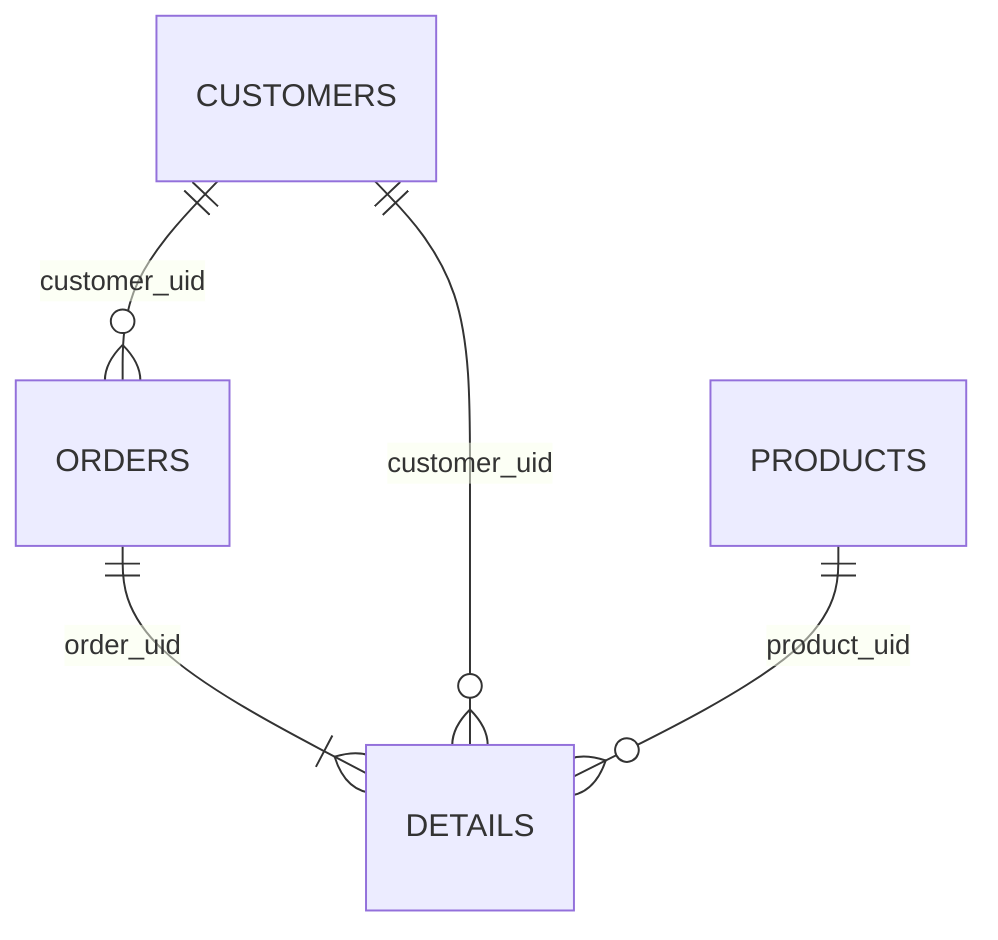

# AdventureWorks related exports

This example uses actual Microsoft AdventureWorks sample fixture files, not invented orders. It exports a large `SalesOrderDetail` dataset plus related order, customer, and product files. The source data is fictitious business data published by Microsoft.

## Run

From the repository root with the Python virtual environment activated:

```sh
python examples/adventureworks/run_demo.py prepare
python examples/adventureworks/run_demo.py export
python examples/adventureworks/run_demo.py verify
python examples/adventureworks/run_demo.py export --resume
```

`prepare` downloads about 24 MB once from the pinned Microsoft commit, checks SHA-256 hashes, and creates local JSONL fixtures. After preparation, export and verification are offline. If prepared data already exists, skip `prepare`; it deliberately does not overwrite it. No SQL Server connection is used in these commands.

The committed configs use `.mapping.xlsx`. The equivalent `.mapping.json` files are included for source review and machine-generated mappings. Each pair passes the same validation and has the same semantic fingerprint. After you edit one representation, the other is not automatically synchronized; the config's `mapping` path is authoritative.

## Generated files

Transactions cover `[2022-07-01, 2025-07-01)`, a fixed three-year period matching the pinned sample's dates. It does not represent the last three years relative to today's date. Details use their parent order's OrderDate, not their own ModifiedDate, keeping each detail in the same window as its parent. Customers and products are one reference snapshot each, containing only keys used by selected transactions.

| Export | Rows | TXT files | Location |
| --- | ---: | ---: | --- |
| Orders | 31,201 | 36 monthly | `exports/adventureworks/orders/` |
| Details | 120,029 | 36 monthly | `exports/adventureworks/details/` |
| Customers | 19,101 | 1 snapshot | `exports/adventureworks/customers/` |
| Products | 266 | 1 snapshot | `exports/adventureworks/products/` |
| Total | 170,597 | 74 | Each TXT has a completion manifest. |

`verification.json` in the parent export folder records counts, first rows, uniqueness, identity generation, and reference checks. `provenance.json` records source URLs, commit, hashes, raw and selected counts, and preparation rules. Only completed TXT/JSON pairs are valid output.

## Related generated identities



| Output identity | Namespace | Ordered source keys |
| --- | --- | --- |
| order_uid in orders and details | `adventureworks/order` | integer SalesOrderID |
| customer_uid in customers, orders, details | `adventureworks/customer` | integer CustomerID |
| product_uid in products and details | `adventureworks/product` | integer ProductID |
| detail_uid in details | `adventureworks/order-line` | integer SalesOrderID, integer SalesOrderDetailID |

Each identity is a stable UUIDv5 generated by a mapping rule. Namespace and ordered, typed key values determine the ID. The same foreign key produces the same UUID in separate files, across month boundaries, and after restart. UUIDs are identifiers, not anonymization and not SQL IDENTITY/autoincrement values. The export adds output columns; it does not alter SQL table schemas.

Example rule for an additional generated column with blank source:

```json
[{"op":"identity","namespace":"adventureworks/order","keys":["SalesOrderID"]}]
```

To add another identity, add a target row to the mapping, give it the next ordinal, use string/non-null type, and set its identity namespace and keys. Keep the same namespace and compatible key types in every referencing file. If a source stores the same key as text in one table and integer in another, reconcile it in a staging layer first; these intentionally produce different UUIDs.

## Prefix/suffix and composed reference examples

| Target | Rule result |
| --- | --- |
| order_reference | `43659` → `AW-SO-43659-WEB` using to_string, prefix, suffix |
| line_reference | order 43659 and line 1 → `AW-LINE-43659/1-ITEM` using template, prefix, suffix |
| account_reference | `AW00029825` → `CRM-AW00029825-ACTIVE` |
| catalog_reference | `BK-M82S-38` → `AW-BK-M82S-38-CAT` |
| tracking_reference | NULL → `TRACK-UNTRACKED-AW` using default, prefix, suffix |

These are explanatory rule examples; the 43659 order precedes the selected three-year interval. Inspect verification.json for actual included records. Prefix/suffix operate on text. For numeric input, include to_string first. Appending here means adding text to field values or adding mapped target columns, not appending rows to an existing TXT.

## Background normalization from a general document

`general_mapping.md` describes the six order outputs in ordinary business language. To standardize it through the installed Codex CLI:

```sh
sql-exporter mapping-job start --input examples/adventureworks/general_mapping.md
sql-exporter mapping-job status --job-dir .mapping-jobs/RETURNED_JOB_ID
```

The background worker writes proposed canonical JSON to `mappings/aw_orders.json` inside the returned job directory. It validates all operations and records unresolved requirements as failures/issues. It does not edit a config or run an export. Review the output and copy the JSON into your mapping folder, then reference it from a config. The supplied `normalization-example/aw_orders.json` is the actual successful Codex result from the development run, with `evidence.json` recording its comparison to the independently defined example.

See `docs/DEVELOPER_GUIDE.md` for installation, status/cancellation, logs, external CLI adapters, and the full development workflow.

## Optional real SQL Server

`stage_sqlserver.sql` creates four new tables under `ExportAW` in a restored sample database. It joins detail rows to selected order headers and selects only referenced customers/products. It never drops or updates source tables, and it is not run automatically. Use a stable restored copy while preparing the related tables. Treat a failed partial staging setup as incomplete; inspect it and use a fresh schema/database before exporting.

After a developer executes the reviewed staging SQL, sets SQL_EXPORTER_CONNECTION_STRING, and installs the native ODBC dependencies:

```sh
sql-exporter validate --config examples/adventureworks/orders.sqlserver.json --connect
sql-exporter export --config examples/adventureworks/orders.sqlserver.json
sql-exporter export --config examples/adventureworks/details.sqlserver.json
sql-exporter export --config examples/adventureworks/customers.sqlserver.json
sql-exporter export --config examples/adventureworks/products.sqlserver.json
```

These configs write to `exports/adventureworks-sql/`. The offline runner/verify command is specifically configured for the pinned file example, not those SQL outputs. Other AdventureWorks releases can have different dates/counts; first inspect MIN/MAX(OrderDate), then adjust both the staging SQL and configs. The background normalization and offline data export were tested; this SQL staging/export route has not been executed against a live server.

## References and license

- [Microsoft AdventureWorks repository](https://github.com/microsoft/sql-server-samples/tree/b47eadc85277f72843647223cde53aa1b85ffcb8/samples/databases/adventure-works/oltp-install-script): pinned source files and schema. The original inputs have 31,465 headers, 121,317 details, 19,820 customers, and 504 products (counts measured during preparation).
- [Microsoft sample database setup](https://learn.microsoft.com/en-us/sql/samples/adventureworks-install-configure): official installation guidance.
- `MICROSOFT_LICENSE.txt`: upstream MIT license for the Microsoft sample code/data distribution, retained with this example.

The prepared fixtures retain selected source values and add only the documented enrichment/snapshot fields. The Microsoft source has date values without timezone information; this example explicitly interprets them as UTC for the export contract.
